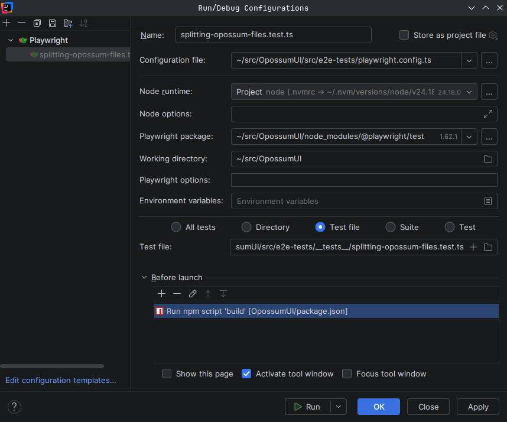

<!--
SPDX-FileCopyrightText: Meta Platforms, Inc. and its affiliates
SPDX-FileCopyrightText: TNG Technology Consulting GmbH <https://www.tngtech.com>

SPDX-License-Identifier: CC0-1.0
-->

# Contributing

Contributions are very welcome. The following will provide some helpful guidelines.

## How to contribute

### Commits

Each commit should be atomic and pass all tests. Logically unrelated changes should not be gathered in one commit.

We use [conventional commits](https://www.conventionalcommits.org/) of the following form:

```txt
<type>[optional scope]: <description>

[optional body]

[optional footer]
```

where `<type>` is one of

```txt
[
  'build',
  'chore',
  'ci',
  'docs',
  'feat',
  'fix',
  'perf',
  'refactor',
  'revert',
  'style',
  'test'
]
```

Example:

```txt
fix: minor typos in code

see the issue for details on the typos fixed

fixes issue #12
```

Furthermore, commits should be signed off according to the [DCO](DCO.md).

### Pull requests

Pull requests should have a clear description that fully elaborates the context and the reason for a change.
The corresponding template should be used. If your pull request resolves an issue, please add a respective
line to the end.

## Developer's guide

OpossumUI is an Electron app written in TypeScript. The frontend uses React (where functional components are used
whenever possible) with Redux for state management.

### OS

Development under Linux and macOS is fully supported: Development under Windows has currently the following limitations:

- only Windows executables can be built.

### Repo setup

Clone the OpossumUI repo. E.g. run the following command in a terminal:

```bash
git clone git@github.com:opossum-tool/OpossumUI.git
```

OpossumUI requires the exact node.js version pinned in the [.nvmrc](.nvmrc) file. If you use [nvm](https://github.com/nvm-sh/nvm), go to the repository root directory and run the following command to install and use this node version:

```bash
nvm install
```

To install dependencies and set up the working environment, go to the repository root directory and run:

```bash
yarn install
```

All useful scripts are listed in the package.json and can be run through `yarn` and can be called after cloning the
repository and installing all dependencies. To start the app based on the current state of the code, including automatic
updates after changes to the frontend, execute:

```bash
yarn start
```

Unit tests are provided for all features. The testing framework is Vitest + Testing Library. They can be run by executing:

```bash
yarn test:unit
```

Integration tests render the full app (frontend against a real, SQLite-backed backend) in a simulated browser. They sit between the
unit and end-to-end tests: slower than unit tests, but without the startup cost of Electron. They can be run using:

```bash
yarn test:int
```

End-to-end tests launch the packaged Electron app and cover everything a renderer-only test cannot observe, e.g. native menus,
dialogs, multi-window and file-IO behavior. They are slower and can be run using:

```bash
yarn test:e2e
```

Prettier is used as a code formatter.

### Requirements

The following software is required for working on the repository:

- [git](https://git-scm.com/),
- [node.js](https://nodejs.org/) in the exact version pinned in the [.nvmrc](.nvmrc) file (install it with `nvm install` if you use [nvm](https://github.com/nvm-sh/nvm)),
- [yarn](https://yarnpkg.com/en/),
- [reuse/tool](https://git.fsfe.org/reuse/tool#install) (to check that copyright information is provided, for more context see [here](https://reuse.software/)),
- [wine](https://www.winehq.org/) (only to build the Windows version).

### Running the end-to-end tests

As mentioned above, the end-to-end tests can be run using `yarn test:e2e`. This runs the tests against the dev server. To run the tests against a built version of the app, which is also what the CI/CD pipeline does, run `yarn test:e2e:ci`. See below for how to build the app for your OS.

On Linux, you can run the full suite without Electron windows appearing on or taking focus from your desktop with:

```bash
yarn test:e2e:xvfb
```

This command builds the app and runs the tests in a virtual X11 display. It requires `xvfb-run`.

If you use VSCode, we recommend you install the [Playwright Test for VSCode extension](https://marketplace.visualstudio.com/items?itemName=ms-playwright.playwright). This will allow you running individual tests from within VSCode, either by clicking the green play button next to a test, or by going to the "testing" tab in the sidebar.

If you use IntelliJ Ultimate, you can install the [Test Automation Plugin](https://plugins.jetbrains.com/plugin/20175-test-automation). This provides green play buttons next to the tests, and the possibility to run tests via the "Run" menu or tab. As for VSCode, please note, that you need to run the test against a built version of the app. Your test configuration should look similar to the one below.



Please note, that there seem to be some issues with this plugin. It can help to invalidate caches ("File" -> "Invalidate Caches...") and restart IntelliJ.

### Debugging the end-to-end tests

Each executed end-to-end test creates artifacts in the folder `src/e2e-tests/artifacts`. The artifacts contain the auto-generated .opossum file that the test was run against and a Playwright trace file.

The trace file includes screenshots and DOM snapshots at each step of the test up to the failure. You can open this file (do not unzip it!) in your browser by going to the [Playwright Trace Viewer](https://trace.playwright.dev/).

The artifacts just described are also available as a download on the GitHub actions summary tab of any build pipeline that failed due to an end-to-end test.

Last but not least, you can use the `debug` fixture to make any end-to-end test exit at a particular point in a test to then inspect the resulting .opossum file in OpossumUI:

```javascript
test('updates progress bar and confidence when user confirms preselected attributions in audit view', async ({
   attributionDetails,
   resourceBrowser,
   resourceDetails,
   topBar,
   debug,
}) => {
   await resourceBrowser.goto(resourceName1);
   await attributionDetails.assert.matchPackageInfo(packageInfo1);
   await topBar.assert.progressBarTooltipShowsValues({
      numberOfFiles: 4,
      filesWithOnlyPreSelectedAttributions: 4,
   });
   debug(); // the test will exit here
   await attributionDetails.assert.confirmButtonIsVisible();
   await attributionDetails.assert.confirmGloballyButtonIsVisible();
```

### Building the app

To build for a single OS run either `yarn ship-linux`, `yarn ship-win`, `yarn ship-mac:x64`, or `yarn ship-mac:arm64`.
On macOS, `yarn ship:auto` selects the matching macOS target automatically. The built release(s) can be found under
_/release_.

**Important:** [wine](https://www.winehq.org/) might be required to build a Windows installer on Linux.

## Creating a new release

Note: You will need the "maintain" role in order to create a new release.

### Checklist

1. **Test** on a large real-world example.
   1. Create a build for your OS using `yarn ship:auto` (see _/release_ folder).
   1. Check performances on a large .opossum file.
   1. Check that the layout does not break at lower resolutions (you can use View → Zoom in OpossumUI and resize the window, don't need to change resolution).
   1. Check that the performance of the save operation is good.
   1. Check that the notices for the app itself and chromium are accessible via the menu.
1. **Start** the Publish release workflow (see next section for details).
1. Optional: Notify users about a new release.
   1. Wait until all the artifacts are shown on Github before sending a message.
   1. Briefly mention the most important changes.

### Creating a release

1. Open [Actions → Publish release](https://github.com/opossum-tool/OpossumUI/actions/workflows/publish-release.yml).
1. Click **Run workflow**, select the branch or tag to release (normally `main`), and confirm **Run workflow**.
1. Wait for the workflow to publish the release. It pins the selected ref to its commit SHA, chooses a UTC date tag such as `OpossumUI-2026-10-23` (then `.1`, `.2`, etc. for additional releases that day), and creates a draft with automatically generated notes excluding Renovate. All platform downloads, update manifests, the user guide, and the SPDX document are uploaded before publication. Performance testing runs after publication and reports separately; its result does not gate publication.

Release runs are serialized. The workflow rejects a version that would not be newer than an already published release and checks again before publication.

### Retrying a release

If preparation, a build, or an upload fails, use **Re-run failed jobs** or **Re-run all jobs** on the original workflow run. The draft records the workflow run ID and pinned commit, so retries reuse the same tag and commit even after midnight or after the branch has moved. Keep the draft and its run marker in the release notes intact until the release is complete. Starting a new workflow run prepares a separate release.

Retries can replace assets only while the release is a draft. Re-running preparation for an already published release skips builds and uploads and treats publication as complete. If only performance testing fails, retry that job; the release is already published.

### Testing automatic updates on Linux and Windows

To test automatic updates, set the packaged version to an old version with

```sh
yarn ship:auto -c.extraMetadata.version=2026.1020.0
```
