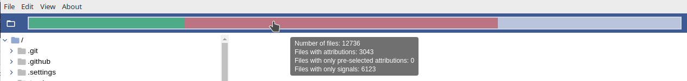
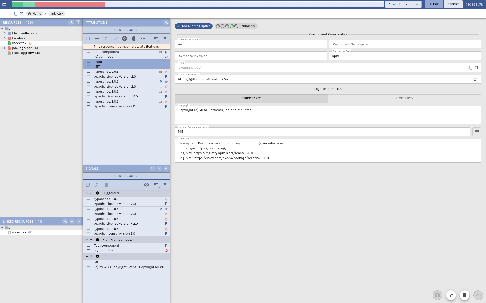
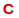
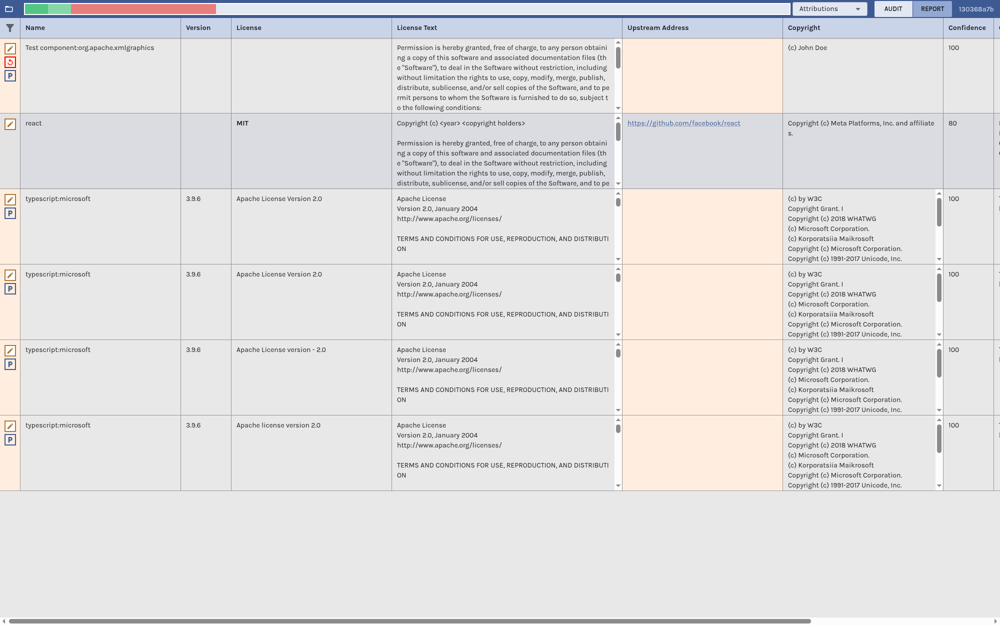
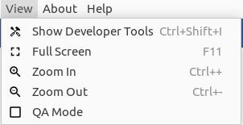
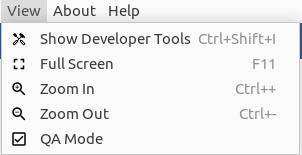

<!--
SPDX-FileCopyrightText: Meta Platforms, Inc. and its affiliates
SPDX-FileCopyrightText: TNG Technology Consulting GmbH <https://www.tngtech.com>

SPDX-License-Identifier: CC0-1.0
-->

# User Guide

## Table of contents

- [Getting Started](#getting-started)
  - [Get the latest release](#get-the-latest-release)
  - [Running the app](#running-the-app)
- [Working with OpossumUI](#working-with-opossumui)
  - [Opossum file format](#opossum-file-format)
  - [Opening a file](#opening-a-file)
  - [Importing a File](#importing-a-file)
  - [Importing Additional Information](#importing-additional-information)
  - [Splitting and Merging Projects](#splitting-and-merging-projects)
  - [Classifying Signals](#classifying-signals)
  - [Project Metadata](#project-metadata)
  - [Project Statistics](#project-statistics)
  - [Exporting Formats](#exporting-formats)
  - [Attributions](#attributions)
  - [Searching and Filtering](#searching-and-filtering)
  - [Top Bar](#top-bar)
  - [Audit View](#audit-view)
  - [Report View](#report-view)
  - [Preferred Attributions](#preferred-attributions)

## Getting Started

### Get the latest release

Download the latest release for your OS from [GitHub](https://github.com/opossum-tool/OpossumUI/releases/latest).

To check if your installation is up-to-date, open the `Help` menu and select `Check for Updates`.

Windows installations and Linux AppImages offer **Download update** when a newer release is found. Downloading starts only when you click this button. The banner shows download progress, then offers **Restart and update**. Installation requires this explicit action; ordinary quitting and dismissing the banner do not install the download. If a download fails, use **Retry**.

If there are unsaved edits in the attribution details, restarting shows the unsaved-changes prompt. Choose **Discard and Proceed** to continue or **Cancel** to keep editing. To save your changes, cancel, save in the editor, then choose **Restart and update** again. The installer handles installation and application exit.

The automatic-check preference controls checks at startup and hourly in the background. Turning it off still allows a manual check and downloading an update by clicking **Download update**. macOS and Snap installations continue to offer a download link.

### Running the app

#### Linux

Run the executable _OpossumUI-for-linux.AppImage_

#### MacOS

Run _OpossumUI_ in _OpossumUI-for-mac-intel.zip_ (Intel Macs) or _OpossumUI-for-mac-arm64.zip_ (Apple Silicon Macs).

#### Windows

Run _OpossumUI-for-win.exe_ to install the OpossumUI. Then open _OpossumUI_ from the start menu.

## Working with OpossumUI

### Opossum file format

Files with a `.opossum` extension are zip-archives which contain:

- an input file (`input.json`)
- (optionally) an output file (`output.json`), which is created by the app when saving for the first time if not already present.

Both files are stored inside the `.opossum` archive.

### Opening a File

To open a `.opossum` file in the app, simply click the _Open File_ button on the left of the top bar (or select _Open..._ from
the _File_ menu).

To quickly access recently opened files, select the relevant file from the `Open Recent` submenu.

### Importing a File

To import a legacy opossum file (`.json`/`.json.gz`) or a file produced by a scanner (e.g. a ScanCode JSON file), click
the _Import_ item in the _File_ menu and select the desired file format from the submenu. You will be presented
with a dialog window where you can select the file that you wish to import. To create a new project, turn off
_Import into current project_ if a project is already open, and select where the new `.opossum` file should be saved.
Clicking the _Import_ button converts the file into a new `.opossum` file and opens it in OpossumUI.
Please note that edits made through OpossumUI are **ONLY** saved in this new `.opossum` file, **NOT** in the file you
selected for import.

### Importing Additional Information

To enrich your currently open file with additional information from a different scanner, open the _Import_ item in the _File_ menu and select the desired file format. Leave _Import into current project_ enabled, select the file to import, and click _Import_. OpossumUI backs up the current project before importing. The _Merge_ item is used to merge split Opossum files instead.

Note:

- Importing into the current project modifies your currently open `.opossum` file and cannot be undone in the app.
- Ensure that the paths in the imported file and the currently open file agree. Currently, there is no functionality to compensate differences.

### Splitting and Merging Projects

To divide a review between several people, choose `Split…` in the `File` menu, select the resources to hand off, and choose a location for the new `.opossum` file. These resources become read-only in the original file and editable in the new file; the rest of the project is read-only in the new file.

After reviewing, use `Merge...` in the `File` menu to combine the split files, either into the currently open project or into a new `.opossum` file.

#### Read-Only Resources and Attributions

Read-only resources and attributions are marked with a padlock. You can inspect them, but cannot edit them. If an attribution is shared between editable and read-only resources, changes apply only to its editable links.

If the other split files have been lost, `File` → `Force Unlock…` makes the read-only parts editable again. After force-unlocking, the file can no longer be merged with the other split files.

### Classifying Signals

To classify the severity of the various signals, OpossumUI supports two mechanisms.

- **Criticality**: This classification encompasses three different levels:
  - Non-critical/unknown
  - Medium critical
  - Highly critical
- **Classification**: The classification allows the creator of the `.opossum` file to predefine a severity schema of the form: `severityLevel --> description`. `severityLevel` needs to be a non-negative integer. By convention, 0 implies that the signal can be used without issues and the severity rises with higher numbers.

The relevant information needs to be already present in the `.opossum` files.

This information is shown at various places in OpossumUI. You can disable the display of the information by de-selecting the relevant entries in the _View_ menu.

### Project Metadata

To view project metadata, open the `File` menu and select `Project Metadata`.

### Project Statistics

To view project statistics, open the `File` menu and select `Project Statistics`. This opens a popup that shows various
charts summarizing the state of the project. Additionally, a table with detailed license statistics is provided.

Click a chart category to open a filtered view of the corresponding attributions, signals or resources in the `Audit View`. For example, `Needs Review` shows attributions awaiting review. License names in the `Licenses` tab also link to the matching resources and signals.

### Exporting Formats

It is possible to directly export data to files. The following formats are available:

- Follow-Up: Just the items marked as follow-up are present in this file as csv file.
- Compact component list: All attributions not marked as follow-up or 1st Party are exported to a csv file. Attributions marked as "exclude from notice" are not exported.
- Detailed component list: All attributions not marked as follow-up or 1st Party are exported to a csv file.
- SPDX JSON: All attributions are listed as JSON file.
- SPDX YAML: All attributions are listed as YAML file.

To generate a document, open the `File` menu and select `Export`.

### Attributions

The basic building block of license/attribution information in the OpossumUI is the **Attribution**. An **Attribution**
isn't only a software package with name & version (or PURL) and copyright, distributed under one or more licenses. It
can in principle be any file which has a copyright or is distributed under a license. **The purpose of the OpossumUI is to
link resources to the corresponding attributions, with an emphasis on correct licensing and copyright information.**
In the OpossumUI, a distinction between **signals** and **attributions** is made:

- **attributions** are attribution information selected or created during the audit. They are stored in
  the output file, together with the resources they have been linked to,
- **signals** are attribution information provided in the input file. They can
  come from automatic tools or earlier audits. They have a **source** and can be used as starting point for
  assigning attributions.

### Searching and Filtering

Use the search fields in the resource browser and attribution/signal panels to find entries. The funnel buttons let you filter the resources, attributions and signals, as well as the table in the `Report View`.

In the `Licenses` filter, you can select several licenses or add a `Name contains` filter to match part of a license name, such as `BSD`. Attribution and signal filters also let you focus on properties such as incomplete information, criticality or classification. The available filters depend on the panel and the settings in the `View` menu.

### Top Bar

The `Top Bar` contains the following elements:

- the _Open File_ button,
- the `Progress Bar`,
- the `Progress Bar Dropdown`,
- the `View Switch`,
- the app version,
- the path bar.

The `Progress Bar` exists in various versions which can be selected via the `Progress Bar Dropdown`. Note that the possibilities offered depend on the settings chosen in the _View_ menu. The following progress bars help track the audit:

- The `Attributions` progress bar indicates how many resources have an attribution (dark green), how many have a **pre-selected** attribution (lighter green with gradient), and how many resources have a signal, but have not yet received an attribution (orange), with respect to the total number of files. Hovering on the bar shows a tooltip containing all numbers. Clicking on the bar navigates to a resource that has a signal, but no attribution.
- The `Criticalities` progress bar indicates how many files without an attribution have a highly critical signal (red), a critical signal (orange) or no critical signal (light blue) with respect to the total number of files not having an attribution. Hovering on the bar shows a tooltip containing the exact number of files. Clicking on the bar navigates to a resource that has a critical signal, but no attribution.
- The `Classifications` progress bar indicates the distribution of the signals without attributions on the configured classification levels. Hovering over the bar shows a tooltip with the exact numbers of all classifications. Clicking on the progress bar navigates to the attribution-less resource with the highest classification level.

The `View Switch` allows to change between the `Audit View` and the `Report View`.

The `path bar` shows the path of the currently selected resource. It also provides options to navigate back and forth in the selection history, to copy the path to the clipboard, and, if possible, to open the resource's source repository in a browser.

### Audit View

**Resource** is the generic name used throughout the app to indicate a file or a folder (as in many cases they are treated the same). The `Audit View` focuses on the navigation through the resources to add/edit/remove attributions while seeing which signals have been found by the remote tools. The page has three main components:

- a resource browser on the left,
- panels to list attributions and signals on the selected resource in the middle,
- and attribution details, if an attribution or signal has been selected, on the right.

#### Resource Browser

In the resource browser, resources can be selected for assigning attributions or inspecting signals. **Icons** help to find information in the folder
structure:

- a **file icon**  indicates that the resource is a file,
- a **folder icon**  indicates that the resource is a folder,
- an **icon consisting of four squares**  indicates that the resource is a breakpoint (**breakpoints** are special folders
  that are included to visually collect a set of dependencies. These folders cannot have any signal or attribution.
  Furthermore, no attribution is inferred beyond such a breakpoint),
- an **exclamation mark**  indicates the presence of signals attached to the resource.
- a **flame icon**  indicates the presence of a critical signal. The color scale indicates the criticality.
- a **C-Icon**  indicates the presence of a signal with non-zero classification. The color scale indicates the number of the classification.

The coloring scheme reads as follows:

- **red** indicates the presence of signals but no attribution for the resource itself,
- **green** indicates the presence of attribution for the resource itself,
- **light red** indicates the presence of signals but no attribution in children,
- **light green** indicates the presence of attribution in children,
- **grey** indicates the absence of both, signals and attribution, in children,
- **blue** indicates the presence of signals in children but no attribution of the resource itself.

Please note that in case a resource has an attribution, this attribution also applies to all of its children that do not have attributions of their own. Therefore, adding an attribution to a folder affects its children if these are not attributed themselves. The inference stops once a folder or a file is hit that has a differing attribution.

At the bottom of the resource browser you will find a panel listing resources linked to the selected attribution or signal. A **chain link icon**  marks a directly linked resource, rather than one covered through inheritance.

#### Attributions Panel

The attributions panel lists attributions as they relate to the selected resource. The possible relationships, by which attributions are grouped into tabs, are:

- **on the selected resource:** attributions directly assigned to the selected resource
- **on children of the selected resource:** attributions assigned to resources contained in the selected resource
- **on parents of the selected resource:** attributions assigned to resources containing the selected resource
- **unrelated:** attributions that are not directly or indirectly linked to the selected resource

Besides searching, sorting, and filtering attributions according to your needs, you can also perform any of the following actions:

- **create new attribution:** creates a new attribution on the selected resource from scratch
- **link as attribution on selected resource:** links the selected attributions to the selected resource (only available if some of the selected attributions are not already linked)
- **confirm:** confirms any of the selected attributions which are pre-selected (P)
- **replace:** enters replacement mode during which you can select a replacement for the selected attributions
- **delete:** deletes the selected attributions

Similar to the resource browser, icons on the attributions are used to highlight relevant properties of the attribution. For an overview, please refer to the Signals Panel section.

#### Signals Panel

The signals panel lists signals as they relate to the selected resource. The possible relationships, by which signals are grouped into tabs, are:

- **on the selected resource:** signals directly assigned to the selected resource
- **on children of the selected resource:** signals assigned to resources contained in the selected resource

Besides searching, sorting, and filtering signals according to your needs, you can also perform any of the following actions:

- **link as attribution on selected resource:** converts the selected signals to attributions and links them to the selected resource
- **delete:** soft-deletes the selected signals, i.e., hides them from the list
- **restore:** restores the selected soft-deleted signals (only available when you include the deleted signals via the show/hide button)
- **show/hide deleted signals:** shows/hides the soft-deleted signals

Similar to the resource browser, icons on attributions and signals are used to highlight relevant properties:

- a **flame icon**  indicates that the signal is marked as critical. The color scale indicates the criticality.
- a **C-Icon**  indicates that the signal features a non-zero classification. The color scale indicates the number of the classification.
- a **P-Icon**  marks the signal as pre-selected.
- an **orange star icon**  marks an attribution as currently preferred.
- a **star icon**  shows that the signal has been preferred in the past.
- a **grey half-star icon**  indicates that an attribution derived from a previously preferred signal has been modified.
- an **icon with a one**  marks the signal as being first party.
- a **replay icon**  marks the signal as requiring follow up.
- an **orange question mark**  marks an attribution as needing review by QA.
- a **text with an x icon**  indicates that the signal is excluded from notice.
- a **checklist with a missing item**  indicates that the signal information is incomplete.

#### Attribution Details

The attribution details show the attributes of the selected attribution or signal. It is here that you can edit and save details of attributions as well. Signals can never be edited (only hidden).

The attributes are divided into three categories:

- **auditing options:** certain annotations and tags that facilitate the auditing process
- **component coordinates:** attributes used to uniquely identify the package
- **legal information:** attributes used to describe the OSS licensing aspects of the package

##### Auditing Options

- _Exclude From Notice_: If chosen, the relative attribution will not be shown in the notice document. In the case of first party code, the respective flag should be used. _Exclude From Notice_ should be used only if:
  - the content of the attribution does not need attribution or
  - the attribution isn't an actual attribution or
  - it was globally decided that this attribution does not need attribution (e.g. it is proprietary but bought for the whole company).
- _Needs Review by QA_: This flag can be used to signal to another OpossumUI user, for example someone performing quality assurance, that an attribution needs review.
- _Needs Follow-Up_: This flag can be used to indicate that the attribution requires follow-up, usually with the development team, as it would be part of a blacklist.
- _Confidence_: This field is used to indicate the confidence in the correctness of the attribution. It is an emoticon on a scale of 1 to 5. You can also filter for attributions with low confidence in the attributions panel.

##### Component Coordinates

These coordinates serve to uniquely identify the package. In particular, component name and component type are required information from which a PURL ("Package URL") is automatically generated. Some component types also require the presence of a namespace. For example, GitHub and Maven packages require a namespace, while NPM packages do not.

Also try to fill the upstream address of the attribution as it often helps to automatically compute the correct license information from it.

Be aware that different package versions may result in different license information. Thus, providing a version whenever possible is also very helpful.

##### Legal Information

Copyright and license name are the most important part of an attribution when it comes to OSS compliance. However, if you are dealing with first-party code, then please select this option in this section. You then no longer will be asked to supply copyright and license name.

##### Editing Shared Attributions

When you save changes to an attribution linked to several resources, a popup shows the affected resources and lets you choose the scope:

- `Save only on Selected` applies the edited information to the selected resource without changing the attribution at its other links.
- `Save on All` applies the edit to all editable links of the attribution.

The same choice is available when confirming pre-selected attributions, using `Confirm only on Selected` or `Confirm on All`.

##### Comparing Attributions and Signals

If an attribution originates from a signal, a `Compare with original` icon button will be displayed in the row of buttons at the bottom of the attribution details. Clicking this button opens a popup where the component coordinates and legal information of both the current attribution and its original signal are displayed side-by-side. Differences are highlighted.

You can copy individual values from the original signal using the arrow buttons between the fields, or edit the attribution directly in the popup. Individual edits can be undone using the undo buttons. Press `Save changes` to apply your edits, or `Cancel` to close the popup without applying them. Signals remain read-only.

To compare with another attribution or signal, select an entry, click `Compare with…` at the bottom of its details, select the second entry, and click `Compare`. The same comparison popup opens, where editable attributions can be changed and values copied between the two sides.

### Report View

In the `Report View` all attributions together with most of their attributes are shown in a table to provide a scrollable overview. As in the attributions panel, you can filter attributions by pressing the funnel icon in the top-left corner.

Clicking on the _edit_ buttons in the _name_ columns, navigates to the respective attribution in the `Audit View`.

### Preferred Attributions

In the `Audit View`, an attribution can be marked as preferred over signals on the resources it covers. This does not hide or modify the signals in OpossumUI. Instead, it is intended to give additional information to tools that consume `.opossum` files.

Only signals with a source marked as `isRelevantForPreferred` can be preferred over. If no signal source has this flag set, the feature is disabled.

To mark an attribution as preferred, choose an attribution in the `Audit View`, and open the auditing options menu. You will see an option to mark the attribution as preferred. When the project is saved, `preferred = true` is written to the `.opossum` file, and the origin IDs of relevant signals on resources covered by the attribution are written in the field `preferredOverOriginIds`, regardless of whether those signals are visible. Preferred attributions are displayed with a star icon.

Note that you are only able to mark an attribution as preferred (or unmark it if it was preferred beforehand) if you are in "QA Mode". To enable this mode click the item "QA Mode" in the `View` submenu.

If "QA Mode" is enabled the icon will change as in the screenshot below.

